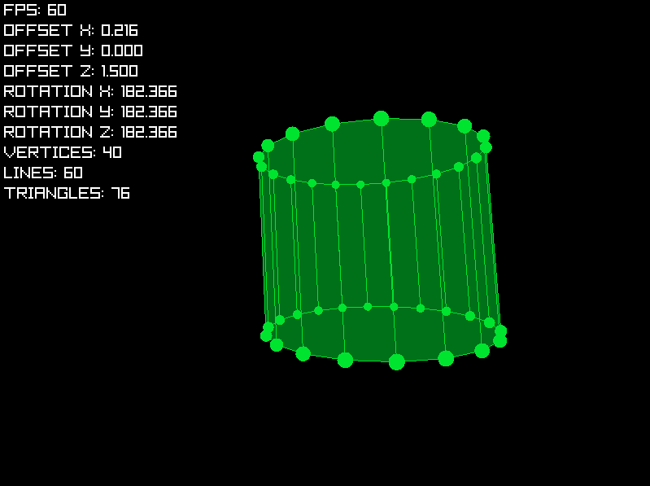

# 3D Toy Renderer
3D toy renderer is a small renderer that can render 3D models from a list of points, lines and triangles. It also supports 3D rotation in X, Y and Z axis. It does not use any of Raylib's 3D rendering functions or a 3D camera. List of models can be found in [source/shapes.c](source/shapes.c).



The program begins by loading all model points, lines and triangles. It rotates the points around and offsets all points based on where the user is located and is looking. Then it translates that point to screen coordinates, stores it and draws the vertices (circles divided by point's Z, this gives the effect of it being 3D). Next up, lines get rendered. They aren't rendered if any of the line's points' Z values are negative. And finally, triangles get rendered in the same manner as lines. Interestingly, Raylib automatically draws a triangle only from one side, meaning no face sorting has to be done (in this situation where all triangles are transparent).

## Controls
- mouse - look around
- A, D - move left/right
- S, W - move forwards/backwards
- Q, E - move up/down
- R - reset position and rotation
- F - change model
- C - change color
- ESCAPE - exit
- I - toggle drawing indices of vertices
- O - toggle drawing vertices
- L - toggle drawing lines
- T - toggle drawing triangles
- H - toggle statistics

## Building
This project depends on Raylib and C++17. You can use CMake to build it:
```bash
cmake -B build
cmake --build build
```
The executable will be located in `build/renderer`. You can also use your favorite compiler:
```bash
gcc -Isource source/*.c -o renderer -lraylib -lGL -lm -lpthread -ldl -lrt -lX11
```

## Credits
This project was made by Daniel Vishnevsky and is licensed under MIT License.
